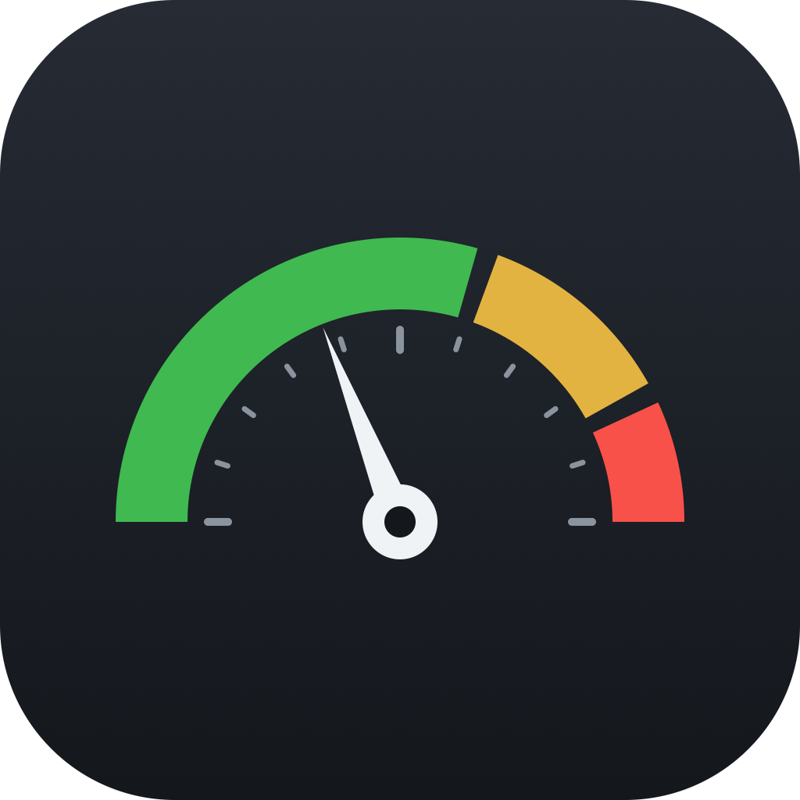

# Claude usage meter

A live usage-limit tracker for Claude Code. See how much of your Claude plan (Pro, Max,
Team or Enterprise) you've used without opening `/usage`. The plugin shows your 5-hour
and weekly rate-limit windows, and when each resets, right above the prompt:

```
5h ▰▰▰▱▱▱▱▱ 38% resets 3:40pm    Week ▰▰▰▰▰▰▰▱ 91% resets Fri 9am
```

In VS Code it moves to the status bar at the bottom right (`5h 38% · Wk 91% · Fable 2%`),
with a table of reset times on hover. Click it to refresh.

The numbers are Anthropic's own figures for your account, the same ones `/usage` shows, so
they include usage from claude.ai, your other sessions and your other machines. The line
above the prompt updates after every reply. The VS Code item also asks Claude Code for
them every 2 minutes while VS Code is focused, so it stays current while you work
elsewhere.

## Install

**Ask Claude.** Paste this into Claude Code:

> Install the usage-meter plugin from github.com/azoni/claude-usage-meter, then set it up in VS Code.

**Or by hand**, at the Claude Code prompt in a terminal:

```
/plugin install usage-meter --marketplace azoni/claude-usage-meter
```

Answer `y` to add the marketplace and pick the user scope. The meter shows up after the
next reply.

**VS Code status bar** (optional): in a Claude Code session, run `/usage-meter:setup-vscode`
or say "set up the usage meter in VS Code". Claude installs the small extension that ships
in this repo. To install it yourself instead:

```
code --install-extension vscode/usage-meter-statusbar.vsix
```

### For AI assistants installing this

Run these from a shell. Neither asks a question.

```
claude plugin marketplace add azoni/claude-usage-meter
claude plugin install usage-meter@claude-usage-meter
```

Then, if the person uses VS Code or Cursor, follow
[skills/setup-vscode/SKILL.md](skills/setup-vscode/SKILL.md) to install
`vscode/usage-meter-statusbar.vsix`. New sessions load the plugin by themselves; if the
current one doesn't show the meter, run `/reload-plugins` or start a new session. Offer to
turn on auto-update (below); don't change their settings without asking.

## Updates

Claude Code doesn't auto-update plugins from community marketplaces unless you turn it on.
Either switch on auto-update for `claude-usage-meter` in `/plugin` (Marketplaces), or add
`"autoUpdate": true` to its entry in `~/.claude/settings.json`:

```json
"extraKnownMarketplaces": {
  "claude-usage-meter": {
    "source": { "source": "github", "repo": "azoni/claude-usage-meter" },
    "autoUpdate": true
  }
}
```

To update by hand instead, then restart Claude Code:

```
claude plugin marketplace update claude-usage-meter
claude plugin update usage-meter@claude-usage-meter
```

The VS Code extension can't update itself, because it's installed from a file. When the
plugin updates and ships a newer one, Claude Code shows a one-line note at startup. Run
`/usage-meter:setup-vscode` to install the new one.

## More than one account

The VS Code item can watch other Claude accounts beside the one you work in. Each account
gets its own folder under `~/.claude/usage-meter/accounts`, and you sign in to it once:

```bash
CLAUDE_CONFIG_DIR=~/.claude/usage-meter/accounts/work claude auth login --email you@example.com
```

Check that the sign-in page shows the right account before you authorize it. A browser
already signed in to Claude offers that account, and the meter would then show it twice.

The folder's name is the account's name in the status bar, which switches to one number per
account: its highest window. An account at 85% or more also shows when that window resets:

```
Main 68% · work 96% resets Fri 11:59 PM · side —
```

`—` means no reading yet, usually because that folder isn't signed in. The hover keeps the
full table for each account, and the item warns when any window on any account reaches 85%.
Accounts are asked one at a time, so each adds a second or so to a refresh.

To remove one, run `claude auth logout` with the same `CLAUDE_CONFIG_DIR`, then delete its
folder. The numbers in a Claude session's plugin reading always count toward `Main`.

## Good to know

- **Subscriptions only.** Pro, Max, Team and Enterprise accounts report these windows. An
  API key or a cloud provider has none, so the meter stays hidden.
- **Per-model weekly limits** (such as a Fable-only week) show in VS Code. The line above
  the prompt shows the 5-hour and weekly windows only, since those are what Claude Code
  passes to plugins.
- **Early-access APIs.** The plugin uses Claude Code's plugin function hooks, and the VS
  Code item uses Claude Code's `get_usage` request; both are marked early access or
  experimental and may change between releases. If the request stops working, the item
  falls back to the numbers saved after each reply. Tested on Claude Code 2.1.314–2.1.318.
- **Your login stays with Claude Code.** The plugin reads the figures Claude Code already
  has and saves them to `~/.claude/usage-meter/`. The VS Code item runs the Claude Code
  program that ships with the Claude extension and asks it for usage (the request behind
  `/usage`). That uses no model tokens and saves no session history. It runs from a
  private folder (`~/.claude/usage-meter/run`) with only your own Claude settings loaded,
  so no project's settings, hooks or MCP servers come along. Neither part reads your
  login or sends anything anywhere else.
- **Something wrong?** In VS Code, open the Output panel and pick "Claude usage meter".
  It says why a refresh failed.
- **Colors.** Green under 60%, yellow from 60%, red from 85%. The VS Code item turns the
  warning color at 85%.

## Remove

```
claude plugin uninstall usage-meter
code --uninstall-extension azoni.usage-meter-statusbar
rm -rf ~/.claude/usage-meter        # the saved readings and version file
```

## Develop

```
claude plugin validate .
claude plugin test .
node --test 'vscode/test/*.test.js'
bash vscode/build.sh        # rebuilds vscode/usage-meter-statusbar.vsix
```

## License

MIT
